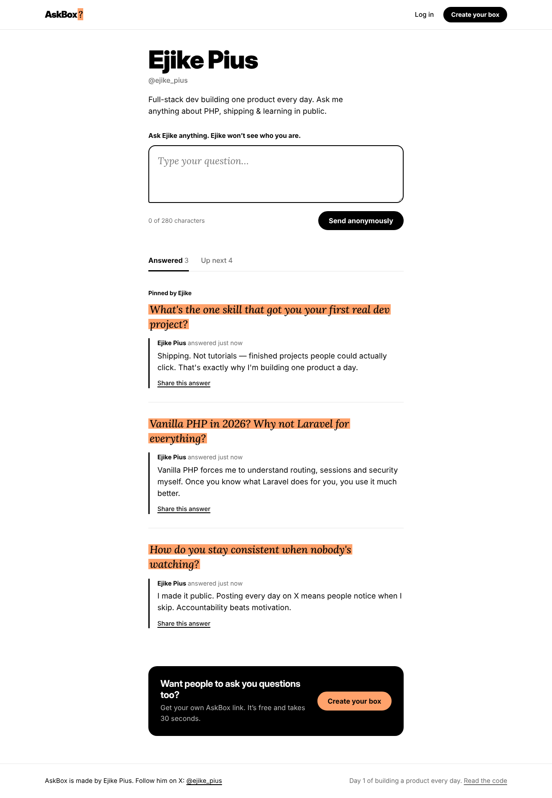
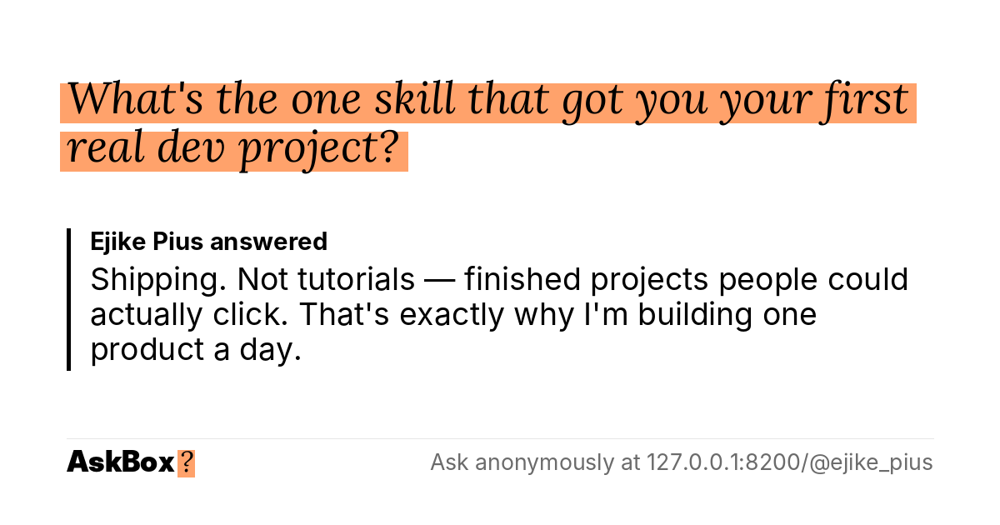
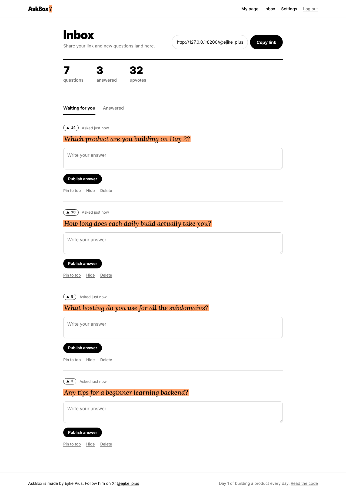

# AskBox

> **Your audience has questions. Let them ask.**
> Day 1 of my daily build challenge by **Ejike Pius** ([@ejike_pius](https://x.com/ejike_pius)): one full-stack product every day.

**Live demo:** https://askbox.ejikepius.dev

AskBox gives anyone a personal link (`askbox.ejikepius.dev/@you`) where their audience can ask questions **anonymously**, **upvote** what they want answered next, and read the answers. Every answer gets its own page with an auto-generated preview image, so posting it on X, WhatsApp or LinkedIn looks great.



## Features

- **Multi-user:** anyone can sign up and claim their own `/@username` box in 30 seconds
- **Anonymous questions:** no account needed to ask
- **"Up next" queue:** visitors upvote unanswered questions, one vote per person
- **Shareable answers:** each answer has its own page plus a 1200×630 share card generated with PHP GD
- **Owner inbox:** answer, edit, pin, hide or delete questions
- **Review-first mode:** new questions stay hidden until the owner approves them
- **Spam protection:** per-visitor rate limits, a honeypot bot trap and a banned-words filter
- **Welcome email:** new users get their link by email, sent over SMTP with a tiny built-in mailer (no PHPMailer)
- **Viral loop:** every box page has a "Get your own AskBox" call-to-action
- Responsive design that works on phones

| Share card (auto-generated) | Owner inbox |
|---|---|
|  |  |

## Under the hood

Built with **vanilla PHP 8 + SQLite**. No framework, no Composer, no build step.

| Concern | How it's handled |
|---|---|
| Routing | One front controller (`public/index.php`) with regex routes like `/@{user}` and `/q/{id}/{action}` |
| Database | PDO + SQLite (WAL mode), tables auto-created on first run |
| SQL injection | Prepared statements everywhere, with whitelisted column names for dynamic SQL |
| XSS | Every value escaped through `e()` on output |
| CSRF | Per-session token on every POST, including the AJAX upvotes |
| Auth | `password_hash` / `password_verify`, session ID regenerated on login, login attempt limit |
| Authorization | Answer, pin, hide and delete check that you own the question (otherwise 404) |
| Double voting | Composite primary key `(question_id, voter_hash)` + `INSERT OR IGNORE` inside a transaction |
| Anonymity | Visitors are identified only by a SHA-256 hash of a random cookie. No IPs are stored |
| Spam | Rate limit (3 questions per 10 min per box), honeypot field, banned-words regex |
| Share images | GD + FreeType with pixel-accurate word wrapping, cached on disk and refreshed when an answer is edited |
| Open redirects | The `back` parameter only accepts local paths |

## Run it locally

Requires PHP 8.1+ with `pdo_sqlite`, `gd` (with FreeType) and `mbstring`, which most PHP installs include.

```bash
git clone https://github.com/pius-developer/askbox.git
cd askbox
php -S localhost:8000 -t public
```

Open http://localhost:8000, create an account, then open your `/@username` page in a private window to ask yourself questions as a visitor.

## Customize it (review guide)

| I want to… | Edit |
|---|---|
| Change the name, creator credit, spam limits or banned words | `src/config.php` |
| Change colors and fonts | `:root` variables at the top of `public/assets/app.css` (questions use Lora italic on an orange highlight; everything else uses Inter) |
| Edit landing page copy | `views/home.php` |
| Edit the welcome email | `views/emails/welcome.php` |
| Set up sending email | Copy `config.local.example.php` to `config.local.php` (see [DEPLOY.md](DEPLOY.md)) |
| Change the share-card design | `src/ShareCard.php` → `render()` |
| Remove upvotes | Delete the `.vote-row` blocks in `views/profile.php` and `views/question.php` (the button itself is `views/partials/vote.php`) |
| Remove the "Create your box" banner | The `.spread` block at the bottom of `views/profile.php` |
| Add a new page | Add a route in `public/index.php` and a view in `views/` |

## Project structure

```
public/          web root: index.php (router), assets/ (CSS, JS, fonts)
src/             config, Database, UserRepository, QuestionRepository, ShareCard, Mailer, helpers
views/           PHP templates (layout, home, profile, question, dashboard, settings, auth, emails/)
data/            SQLite DB + cached share cards (git-ignored)
docs/            screenshots and flyer
```

Deploying to a subdomain: see [DEPLOY.md](DEPLOY.md).

## Credits

Built by **Ejike Pius**. Follow on X: [@ejike_pius](https://x.com/ejike_pius). GitHub: [pius-developer](https://github.com/pius-developer)
Fonts: [Inter](https://rsms.me/inter/) by Rasmus Andersson and [Lora](https://github.com/cyrealtype/Lora-Cyrillic) by Cyreal, both under the SIL Open Font License.

MIT License
